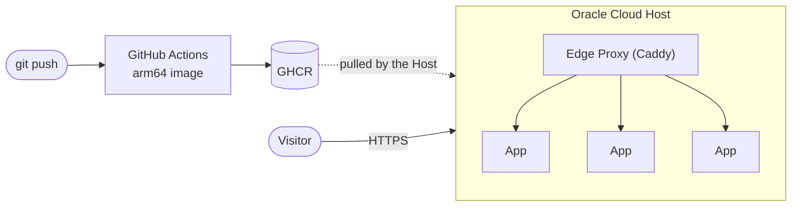

# project-setup

How to host several independent web apps on **one free Oracle Cloud ARM machine**: one subdomain and automatic HTTPS per app, Docker Compose, and deploys that happen by themselves when you push to GitHub.

**📖 Read it as a website: <https://saavuori.github.io/project-setup/>**

- **[The guide → docs/guide.md](docs/guide.md)**: the architecture, the reasoning behind each choice, and the end-to-end path for adding an app.
- **[Vocabulary → CONTEXT.md](CONTEXT.md)**: the terms the guide uses (Host, App, Edge Proxy, Shared Service…) and what each one means exactly.

This is a design guide, not a copy-paste tutorial. It explains *what* to build and *why*, so it stays useful as tool versions change.

## License

© 2026 Sampsa Säävuori. This guide is licensed under [Creative Commons Attribution 4.0 International (CC BY 4.0)](https://creativecommons.org/licenses/by/4.0/). You may share and adapt it for any purpose, as long as you give credit. See [LICENSE](LICENSE).
