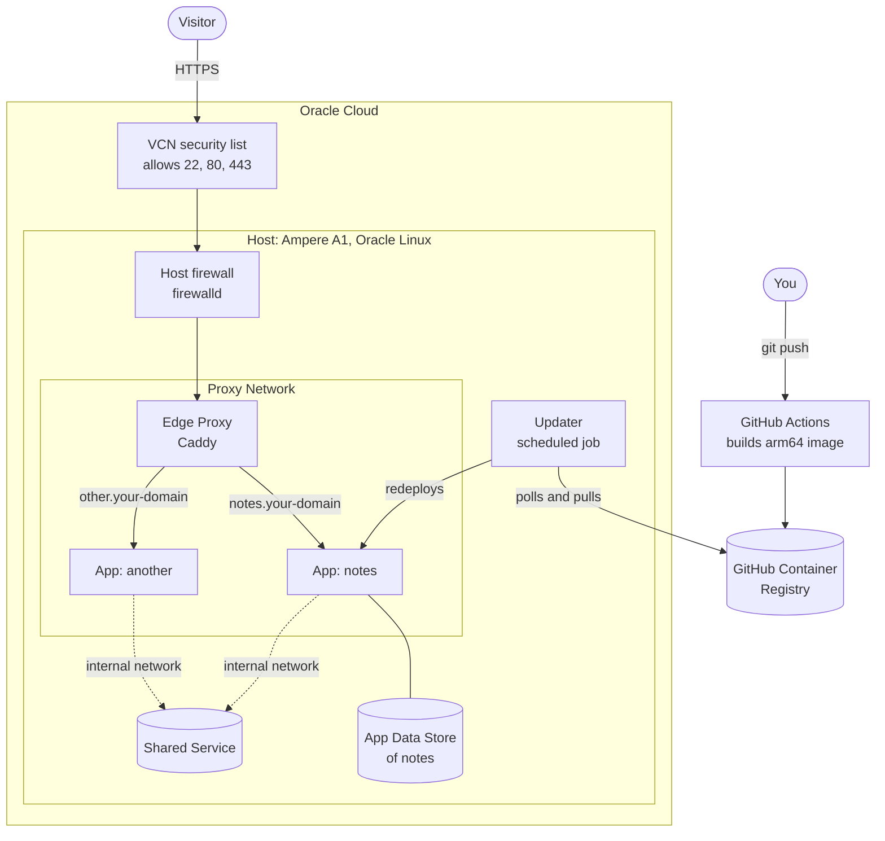
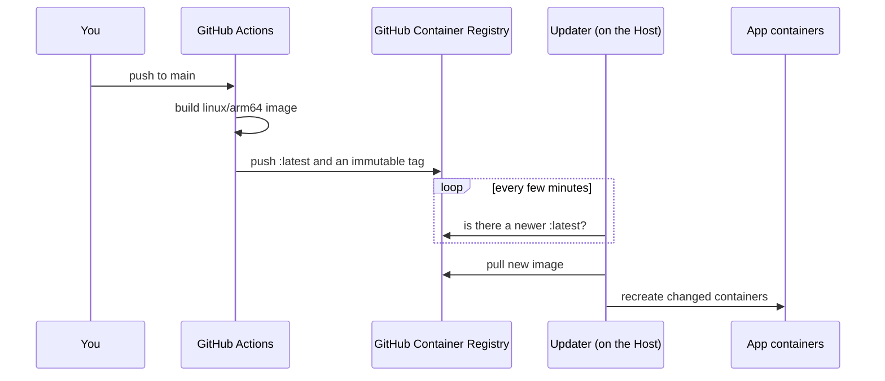

# Hosting several web apps on one free Oracle Cloud machine

An architecture guide for running a handful of independent web apps on a single Oracle Cloud Always Free ARM machine, each on its own HTTPS subdomain, deployed automatically whenever you push to GitHub.

This is a description of the design and the reasoning behind it, not a command-by-command tutorial. The few config fragments are there to show the shape of things, not to be pasted as-is. Placeholders look like `<your-domain>`, `<github-user>` and `<host-ip>`. One invented example App, **notes**, served at `notes.<your-domain>`, is used throughout.

The words **Host**, **App**, **Edge Proxy**, **Proxy Network**, **App Data Store**, **Shared Service** and **Updater** have exact meanings here. They are defined in the [glossary](glossary.md).

## 1. What you end up with

- **One machine, many Apps.** A single Oracle Cloud virtual machine (the **Host**) runs every App as its own Docker Compose project. Apps don't know about each other and can be added or removed independently.
- **Automatic HTTPS on a subdomain per App.** One reverse proxy (the **Edge Proxy**) owns ports 80 and 443, gets and renews certificates by itself, and routes `notes.<your-domain>` to the notes App.
- **Push-to-deploy without giving CI the keys.** Pushing to `main` builds an image in GitHub Actions and publishes it to GitHub Container Registry. A scheduled job on the Host (the **Updater**) notices the new image and redeploys. CI never logs in to the Host.
- **A small public surface.** Only SSH, HTTP and HTTPS are reachable from the internet. Apps and databases publish no ports at all.

Good fit: hobby and side projects, dashboards, small tools for a few hundred users. Poor fit: anything that needs high availability. There is exactly one machine, and when it's down, everything is down.

## 2. Architecture at a glance



Read it in two directions:

- **Requests come in** from the left. They pass Oracle's network firewall, then the Host's firewall, then reach the Edge Proxy. The Edge Proxy picks the App by hostname and forwards the request over the Proxy Network. Apps reach their own App Data Store over their private network, and reach a Shared Service over a separate internal network.
- **Code comes in** from the bottom. You push, GitHub builds and publishes an image, and the Host's Updater pulls it. Nothing ever connects *into* the Host to deploy.

## 3. Vocabulary

The [glossary](glossary.md) defines every term. Two distinctions in it matter most when you read the rest:

- The **Edge Proxy** is shared infrastructure, not part of any App. If it's bundled inside an App's stack, redeploying that App takes every site offline.
- An **App Data Store** belongs to one App. A **Shared Service** belongs to none. A database starts as an App Data Store and becomes a Shared Service only when a second App needs the *same data*.

## 4. The Host

**Account and region.** Create an Oracle Cloud account. Pick your **home region** carefully: Always Free resources can only be created there, and you can't change it later. Choose one close to your users.

**Shape.** Use the **Ampere A1** shape, the ARM (aarch64) machine in Oracle's Always Free tier. At the time of writing, the free allowance is generous enough to give one machine several cores and well over ten gigabytes of memory. Oracle changes these limits, so check the current Always Free terms before you size it. Popular regions often report "out of capacity" for A1. Retrying later, or a smaller shape first, usually works.

ARM matters for everything that follows. **Every image you run must be built for `linux/arm64`.** Most official images (Caddy, Postgres, Redis) publish ARM variants. Your own Apps need CI to build them that way (see [section 11](#11-delivery-pipeline)).

**Operating system.** Use **Oracle Linux** (the current major version). It's the default image, it's well supported on the A1 shape, and the default user is `opc`, with root login and password login already off.

**Networking.** The Host lives in a virtual cloud network (VCN) with a public subnet and a public IP address. That IP is what your DNS records will point at. Write it down. If it ever changes, every App's DNS record must change with it.

## 5. Host baseline

Do this before anything else runs on the Host.

**SSH keys only.** Log in with the key pair you created when launching the machine. Don't enable password authentication. If your own IP is stable, you can also limit port 22 to it in the security list (below).

**Two firewall layers, both must agree.** On Oracle Cloud, traffic passes two separate firewalls, and a port is reachable only when **both** allow it:

| Layer | Where it lives | Allow |
|---|---|---|
| VCN security list (or network security group) | Oracle Cloud console, on the subnet | TCP 22, 80, 443 (plus UDP 443 if you want HTTP/3) |
| Host firewall (`firewalld`) | On the Host itself | `ssh`, `http`, `https` |

Open nothing else. "The App is running but I can't reach it from outside" is almost always one of these two layers. Check both.

**Automatic security updates.** Turn on Oracle Linux's automatic updater (`dnf-automatic`) for **security updates only**. A machine nobody logs into for months still gets patched, without a surprise major upgrade.

## 6. Container runtime

**Docker Engine with the Compose plugin.** Each App, the Edge Proxy and each Shared Service is its own **Compose project** in its own directory on the Host. Plain Compose is enough for one machine: no Swarm and no Kubernetes. Docker's packages for Red Hat-compatible systems install on Oracle Linux, although Oracle Linux isn't on Docker's officially supported list. Remove Podman first if the image ships it, because the two conflict.

**One shared Proxy Network.** Create one user-defined Docker network once, e.g. `proxy`, outside any Compose project. The Edge Proxy joins it, and so does the public-facing container of each App. Every Compose project declares it as `external`, so no single project owns it and tearing one project down never removes it.

On a user-defined network, Docker's built-in DNS lets containers find each other **by name**. That's how the Edge Proxy reaches `notes-web` without anyone publishing a port.

!!! warning "Published ports skip `firewalld`"
    When a container publishes a port (`ports:` in Compose), Docker writes its own packet-filtering rules, which take effect *before* the Host firewall's zone rules are checked. A published port is reachable from anywhere Oracle's security list allows, whatever `firewalld` says. So the rule is: **only the Edge Proxy publishes ports (80 and 443).** Nothing else has a `ports:` section. If you need to reach a database from your laptop, publish it on `127.0.0.1` only and connect through an SSH tunnel.

## 7. The Edge Proxy

**Caddy, in its own Compose project.** The Edge Proxy is [Caddy](https://caddyserver.com/). It gets and renews a TLS certificate for each hostname automatically, as soon as that hostname's DNS points at the Host and ports 80/443 are reachable. It lives in its own directory and Compose project, and it's the only thing on the Host that publishes ports.

**One route per App.** The configuration (the Caddyfile) has one block per public hostname. Each block names the App's container on the Proxy Network:

```caddyfile
notes.<your-domain> {
	encode zstd gzip
	reverse_proxy notes-web:8080
}
```

Adding an App means adding a block like this and telling Caddy to **reload**. A reload swaps the configuration without dropping connections. Validate the file first: a broken configuration that gets loaded takes every site down at once.

Two design points that are easy to miss:

- **Keep Caddy's data directory on a named volume.** That's where certificates live. If they're lost on every redeploy, Caddy requests fresh ones each time and soon hits the certificate authority's rate limits.
- **Mount the configuration *directory* into the container, not the single file.** Many editors save by writing a new file and renaming it over the old one. A container that bind-mounted the single file keeps seeing the old version, and a reload quietly reloads stale configuration.

## 8. Anatomy of an App

Every App has the same shape, which keeps a Host with ten Apps as easy to understand as a Host with one.

**A directory per App** on the Host (e.g. `~/apps/notes/`) holding:

- the App's **Compose file**,
- the App's **env file** with its secrets and settings,
- nothing else that matters. The code lives in the image, not on the Host.

**A Compose project per App.** The public-facing service joins the Proxy Network under a **unique container name**, and has **no `ports:` section**:

```yaml
services:
  web:
    image: ghcr.io/<github-user>/notes:latest
    container_name: notes-web
    restart: unless-stopped
    env_file: .env
    networks: [proxy, default]
networks:
  proxy: { external: true }
```

The unique name matters because every App's main service tends to be called `web`. On the shared Proxy Network, those names would collide, and the Edge Proxy would route to whichever container answered first. `notes-web`, `shop-web` and so on keep routing unambiguous.

`restart: unless-stopped` brings the App back after a crash or a Host reboot. No separate service manager is needed.

**An optional App Data Store.** If the App needs a database or cache, it goes **inside the App's own Compose project**, as another service on the App's private `default` network, with its data on a named volume. It does **not** join the Proxy Network, so the Edge Proxy (and every other App) can't see it. Deleting the App deletes its data store, and nothing else breaks.

**Secrets in the env file, nowhere else.** API keys and passwords live in the App's env file on the Host, readable only by the user that runs Docker. They're never baked into the image, committed to the repo or stored in CI. The image is the same for everyone. The env file is what makes it *your* deployment.

## 9. Shared Services

**When something becomes a Shared Service.** Only when two or more Apps need the **same data**, for example a time-series database that several dashboards read from. Two Apps that each need *a* Postgres get two App Data Stores, not one Shared Service.

**How it's built.** A Shared Service is its own Compose project in its own directory, like an App, with two differences:

- It **never joins the Proxy Network** and is never routed by the Edge Proxy.
- It creates its **own internal network** (e.g. `shared-db`). The Apps that use it join that network as `external`, and the Apps that don't use it never see it.

Apps reach it by container name over that network, the same way the Edge Proxy reaches Apps. Each App gets its **own credentials** for the Shared Service, in its own env file, with only the permissions it needs.

**Why it never publishes a port.** A database on a published port is reachable from the internet as soon as anyone opens that port in the security list, and Docker's rules mean `firewalld` won't stop it (see the [warning above](#6-container-runtime)). Most databases speak plain, unencrypted protocols by default, so credentials would cross the internet in the clear. Keeping a Shared Service on an internal network means that mistake simply can't happen.

## 10. DNS

**One A record per App.** At your domain's DNS provider, each App gets an A record pointing its hostname at the Host's public IP:

| Name | Type | Value |
|---|---|---|
| `notes` | A | `<host-ip>` |
| `shop` | A | `<host-ip>` |

**Order matters: DNS first, then the Edge Proxy route.** Caddy requests a certificate as soon as it loads a new hostname. If the DNS record isn't in place yet, validation fails, and repeated failures count against the certificate authority's rate limits. Create the record, check that it resolves, then add the route.

Newly created names can look missing for a while from some resolvers, because an earlier "no such name" answer is still cached. When checking a fresh record, ask your DNS provider's authoritative name servers directly rather than a public resolver.

## 11. Delivery pipeline



**Build in GitHub Actions, for ARM.** Each App's repository has a workflow that, on every push to `main`, builds the image for **`linux/arm64`** and pushes it to GitHub Container Registry. There are two ways to get ARM builds: GitHub's ARM-hosted runners (native and fast), or an x86 runner with emulation through Docker Buildx (works everywhere, but slower). Without one of them, the image is built for x86, and the first deploy fails with an "exec format error".

**Two tags per build.** Push `:latest`, which the Host follows, and an **immutable tag** (a version number or the commit SHA). The immutable tag is your rollback: to go back, point the App's Compose file at the previous tag.

**The Updater pulls, CI never pushes.** On the Host, a scheduled job (cron or a systemd timer) runs every few minutes for each App. It pulls the App's image, compares it to what's running, and if it's newer, runs `docker compose up -d` for that App. That recreates only the containers whose image changed and leaves the rest alone.

This direction is deliberate:

- **CI holds no keys to the Host.** A leaked workflow secret can publish a bad image, but it can't log in to your machine.
- **The Host needs no inbound deploy port.** The only thing it opens to the internet is what the Edge Proxy serves.
- **If the image is public,** the Host needs no registry credentials at all. If it's private, give the Host a token that can **only read** packages.

**The Updater ships code, not configuration.** It changes which image runs, nothing else. Changes to an App's Compose file or env file are a deliberate manual step on the Host, followed by `docker compose up -d` for that App.

## 12. Adding a new App

The whole path, for an App called **notes**:

1. **Make the image.** The App's repository builds a `linux/arm64` image in GitHub Actions and pushes `ghcr.io/<github-user>/notes` as `:latest` plus an immutable tag ([section 11](#11-delivery-pipeline)).
2. **Create the App directory** on the Host, with its Compose file (unique container name, joins the Proxy Network, no `ports:`) and its env file (secrets, readable only by the owner) ([section 8](#8-anatomy-of-an-app)).
3. **Add an App Data Store** inside that Compose project if the App needs one. If it needs data another App already owns, join that **Shared Service**'s internal network instead and give the App its own credentials ([section 9](#9-shared-services)).
4. **Start it** with `docker compose up -d`, and check its logs before going further.
5. **Create the DNS record** `notes.<your-domain>` → `<host-ip>`, and wait until it resolves ([section 10](#10-dns)).
6. **Add the Edge Proxy route** for `notes.<your-domain>` → `notes-web:<port>`, validate, and reload ([section 7](#7-the-edge-proxy)). The certificate arrives within seconds.
7. **Schedule the Updater** for the notes App ([section 11](#11-delivery-pipeline)).
8. **Check it from outside**: open `https://notes.<your-domain>` from a machine that isn't the Host. If it works on the Host but not from outside, check the two firewall layers ([section 5](#5-host-baseline)). If it fails on the Host too, check the App's logs.

From then on, a push to `main` is a deploy.
