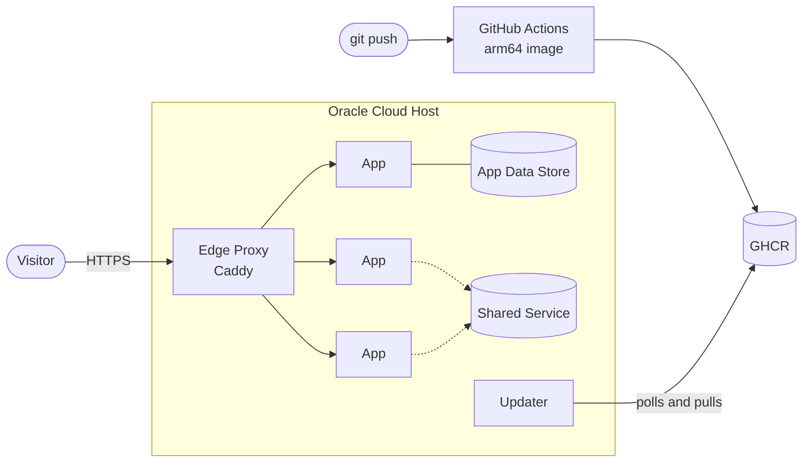

---
hide:
  - navigation
  - toc
---

# One Host, Many Apps

A design guide for hosting several independent web apps on <strong>one free Oracle Cloud ARM machine</strong>: a subdomain and automatic HTTPS for each app, and deploys that happen by themselves when you push to GitHub.

[Read the guide :material-arrow-right:](guide.md){ .md-button .md-button--primary }
[Glossary](glossary.md){ .md-button }

## What you end up with

-   :material-server-network:{ .lg .middle } __One machine, many Apps__

    ---

    Every App is its own Docker Compose project on a single Always Free Ampere A1 Host. Add or remove one without touching the others.

    [:octicons-arrow-right-24: The Host](guide.md#4-the-host)

-   :material-lock-check:{ .lg .middle } __Automatic HTTPS per subdomain__

    ---

    One shared Edge Proxy (Caddy) owns ports 80 and 443, gets certificates by itself and routes each hostname to its App.

    [:octicons-arrow-right-24: The Edge Proxy](guide.md#7-the-edge-proxy)

-   :material-source-branch-sync:{ .lg .middle } __Push-to-deploy, no keys in CI__

    ---

    GitHub Actions builds an arm64 image, and the Host's Updater pulls it. Nothing ever logs in to the Host to deploy.

    [:octicons-arrow-right-24: Delivery pipeline](guide.md#11-delivery-pipeline)

-   :material-shield-half-full:{ .lg .middle } __A small public surface__

    ---

    Only SSH, HTTP and HTTPS are reachable. Apps and databases publish no ports, so a misconfigured firewall can't expose them.

    [:octicons-arrow-right-24: Host baseline](guide.md#5-host-baseline)

## The whole system on one page

Requests come in through the Edge Proxy, and code comes in through the Updater. The [guide](guide.md) walks through each part in the order you'd build it, and ends with a [checklist for adding a new App](guide.md#12-adding-a-new-app).

!!! note "A design guide, not a copy-paste tutorial"
    It explains *what* to build and *why*, with a few short config fragments to show the shape of things. It stays useful when tool versions change.
